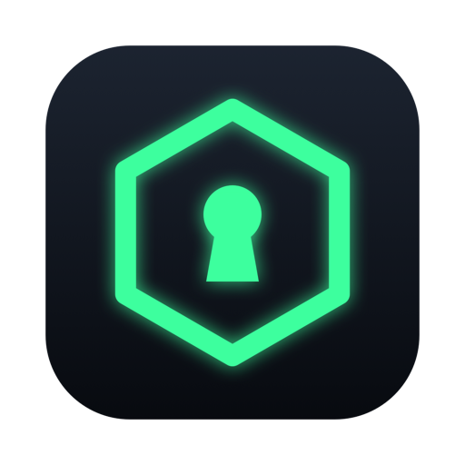
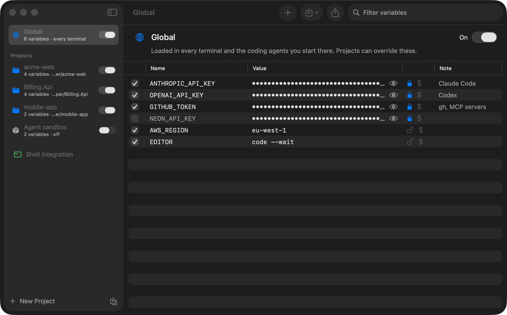

<p align="center">
  
</p>

<h1 align="center">Envy</h1>

<p align="center">
  <strong>Environment variables & secrets for your terminal and AI coding agents — native on macOS and Windows, 100% free & open-source.</strong>
</p>

<p align="center">
  <a href="https://github.com/joeystdio/envy/releases/latest/download/Envy.dmg">
    
  </a>
  <a href="https://github.com/joeystdio/envy/releases/latest/download/Envy-Setup.exe">
    
  </a>
  <a href="https://github.com/joeystdio/envy/releases/latest">
    
  </a>
  
  
  
  <a href="https://buymeacoffee.com/joeystdio">
    
  </a>
</p>

<p align="center">
  
</p>

---

## ✨ Features

- **🔐 Secrets in your Keychain, not your dotfiles**: API keys and tokens live in the macOS Keychain and are masked in the app. No more `export OPENAI_API_KEY=…` in plain text in `~/.zshrc`, where every program you run (coding agents included) can read it.
- **🌍 Global + per-project variables**: Keep **Global** variables that load in every terminal, plus a set per project that adds to or overrides them.
- **📂 Folder-aware, direnv-style**: Link a project to a folder and its variables load the moment a terminal `cd`s in, and unload when it leaves. Anything they overrode gets its old value back.
- **🎚️ One-click on/off**: Switch a whole project or a single variable on or off, from the window or the **menu bar**. Open terminals pick it up at their next prompt, no restart needed.
- **🤖 Built for coding agents**: Claude Code, Codex, Cursor CLI, Gemini CLI, Aider and friends get exactly what's switched on for the folder you start them in, and nothing else.
- **🧠 Agents know how to use it**: Envy teaches your agents the `envy` command. They check what's loaded, add settings, import a `.env` without seeing its values, and when they need a secret they open Envy for **you** to paste it, instead of asking for it in the chat. Claude Code gets a rule; Codex, Gemini CLI, Cursor, Copilot CLI, opencode, Amp and Goose share one skill in `~/.agents/skills`. Envy only writes its own files, never your instructions.
- **📥 Import everything**:
  - Scan a whole folder of code at once for `.env`, `.env.local` and `.envrc` files.
  - **.NET**: `appsettings.json`, `appsettings.Development.json` and `dotnet user-secrets`, flattened the way .NET reads them (`ConnectionStrings:Default` → `ConnectionStrings__Default`).
  - Paste or drop `.env` text, copy variables between projects, export back to `.env`.
- **💾 Back up and move**: **Back Up Everything** saves Global, every project, its folders and variables, secrets included, in one file encrypted with a password you choose. **Restore from Backup** (also in the Setup Assistant on a new machine) adds it to what's there or replaces everything, in one undoable step, on a Mac or a PC: folders under your home folder follow you, and values that expand variables get a suggested rewrite for the other system.
- **🧭 Setup Assistant**: Detects your shell (zsh or bash, `ZDOTDIR`, dotfile symlinks) and the coding agents you have installed. It then connects your terminal, checks that a fresh shell loads Envy, moves plain-text secrets out of your startup files into the Keychain, and teaches your coding agents about Envy.

---

## 📦 Installation

### 🍎 macOS (15 or later, Apple Silicon and Intel)

#### Option 1: Homebrew (Recommended)
```bash
brew tap joeystdio/tap
brew install --cask envy
```

#### Option 2: Direct Download (`.dmg`)
1. Download [**`Envy.dmg`**](https://github.com/joeystdio/envy/releases/latest/download/Envy.dmg) from the [latest release](https://github.com/joeystdio/envy/releases/latest).
2. Open `Envy.dmg` and drag **Envy.app** into your **Applications** folder.
3. Launch **Envy**. The Setup Assistant connects your terminal and imports your projects.

> Envy is signed with a Developer ID and **notarized by Apple**, so it opens without any Gatekeeper warnings.

**Uninstalling:** in Envy's Shell Integration, disconnect your startup files and remove the coding agent instructions first. `brew uninstall --zap --cask envy` also removes Envy's settings, shell files and agent instructions.

### 🪟 Windows (10 and 11, x64)

1. Download [**`Envy-Setup.exe`**](https://github.com/joeystdio/envy/releases/latest/download/Envy-Setup.exe) from the [latest release](https://github.com/joeystdio/envy/releases/latest).
2. Run it. It installs for you only (in `%LOCALAPPDATA%\Programs\Envy`) and needs no admin rights.
3. Envy opens and its Setup Assistant connects PowerShell, Git Bash and Command Prompt, teaches your coding agents about Envy, and imports your projects.

> The Windows installer isn't code-signed yet, so Microsoft Defender SmartScreen warns about an unknown publisher the first time. Click **More info**, then **Run anyway**. If your browser blocks the download, choose **Keep** in its download list. Signing through SignPath Foundation is being set up: see the [code signing policy](CODE_SIGNING_POLICY.md).

**Uninstalling:** Settings → Apps → Installed apps → **Envy** → Uninstall. It takes Envy's line out of your PowerShell profiles and `~/.bashrc` and its part out of Command Prompt's AutoRun, and removes the generated shell files, the `envy` command and the coding agent instructions. Your settings (`%APPDATA%\Envy`) and secrets (Credential Manager, `Envy/…`) stay, so reinstalling brings everything back.

---

## 🚀 Using Envy

Envy adds one marked line to `~/.zshrc` (and/or `~/.bashrc`, `~/.bash_profile`). From then on, every terminal loads whatever you switch on:

| Scope | Loads |
| --- | --- |
| 🌍 **Global** | In every terminal |
| 📦 **Project without a folder** | In every terminal, on top of Global |
| 📂 **Project with linked folders** | Only inside those folders (and subfolders) |

Later wins: Global, then always-on projects (sidebar order), then folder projects (deepest folder last).

In a terminal, or from a script or coding agent:

```bash
envy status                        # what loads here, and whether this process has it
envy list [PROJECT]                # projects and variables (secret values are never shown)
envy set PORT=4000                 # add or update a plain variable in this folder's project
envy add OPENAI_API_KEY --secret   # opens Envy so you can paste the value into the Keychain
envy import .env                   # move a .env into Envy; secrets go to the Keychain
envy project add api --folder .    # a project that loads inside this folder
envy exec -- npm start             # run something with the latest values for this folder
envy help                          # everything else
```

`envy set`, `remove`, `on`/`off` and `import` go to the project linked to the current folder; add `--project NAME` or `--global` for another. Every change goes through the running app (Envy starts in the background if it isn't open), and agents can't read or set secret values: `envy add NAME --secret` asks you. `envy reload` reloads the current terminal right away. On Windows the same commands work in PowerShell, Git Bash and Command Prompt, and secrets go to Credential Manager.

- **🔒 Secret**: stored in the Keychain and masked in the app.
- **💲 Expand**: the value is evaluated like a double-quoted shell string, so `$HOME/bin:$PATH`, `${OTHER}`, `~` and `$(command)` work. Off by default, so values pass through literally.
- **Shortcuts**: ⌘N new variable, ⇧⌘N new project, ⌘I import `.env`, ⇧⌘I import projects from a folder, ⇧⌘E export `.env`, ⇧⌘B back up everything, ⌘Z undo.

<details>
<summary><strong>How the shell hook works</strong></summary>

The line in your startup file sources `~/.config/envy/init.sh`, which also puts `~/.config/envy/bin` on your `PATH`: the `envy` command there runs the app's own executable and talks to the running app over a private socket (starting it in the background if needed), so agents started from your terminal can use it too. The app regenerates `~/.config/envy/vars.sh` (mode 600) whenever you change something. At every prompt, and on `cd` in zsh, the hook checks a generation stamp and the current folder. When either changed, it puts back everything it set earlier and applies the current set. New tabs, tmux panes and editor terminals inherit what their parent applied and clean it up correctly.

Disconnecting from **Shell Integration** removes the line again; a copy of the previous file is kept as `<file>.envy-backup`.
</details>


## 🪟 Envy on Windows

The Windows app is native too (WinUI 3, with Mica and a tray icon instead of the menu bar), and it does the same job:

| Shell | How it loads Envy | Per folder |
| --- | --- | --- |
| **PowerShell 7** and **Windows PowerShell 5.1** | A marked line in your profile (`Documents\PowerShell\profile.ps1`, `Documents\WindowsPowerShell\profile.ps1`) wraps the prompt | ✅ at every prompt, and right on `cd` in PowerShell 7 |
| **Git Bash** | The same marked line as on the Mac, in `~/.bashrc` | ✅ at every prompt |
| **Command Prompt** | Envy is chained onto cmd's `AutoRun` command (`HKCU\Software\Microsoft\Command Processor`), after anything already there | ⚠️ once, when the window opens, for the folder it opens in. Run `envy reload` after `cd` |

- **🔐 Secrets in Credential Manager**: secret values are stored as generic credentials (`Envy/…`), encrypted by Windows for your account. Settings live in `%APPDATA%\Envy`.
- **🧭 Setup Assistant**: finds PowerShell 7, Windows PowerShell, Git Bash and Command Prompt and the coding agents on their PATH, connects the shells and checks that a fresh one of each loads Envy. It also offers to move plain-text secrets out of your PowerShell profiles, `~/.bashrc` and your user environment variables into Credential Manager. Every file it changes keeps a copy as `<file>.envy-backup`.
- **🤖 The `envy` command for coding agents**: connected shells put `envy.exe` on `PATH`, so agents (and scripts) can run `envy status`, `envy set`, `envy import .env` and `envy exec -- <command>`, and ask you for a secret with `envy add NAME --secret`, which opens Envy for you to paste it: the value never passes through the agent. Envy can also teach Claude Code (a rule in `~\.claude\rules`) and Codex, Gemini CLI, Copilot CLI and others (a skill in `~\.agents\skills`) to work this way. The command talks to the app over a named pipe only your account can open.
- **💲 Expand on Windows** fills in `%NAME%`, `$NAME`, `${NAME}`, `$env:NAME` and a leading `~` (your user folder) when a shell loads the value, so `%USERPROFILE%\bin;%PATH%` works in all three shells. Commands such as `$(…)` are not run. Git Bash gets `PATH` converted to its `/c/…` form and back.
- Windows PowerShell only runs profile scripts when your execution policy allows it. If it doesn't, Shell Integration offers to set it to `RemoteSigned` for your account.
- Closing the window keeps Envy in the notification area; right-click its icon to switch Global or a project on or off. Quit from there too.

<details>
<summary><strong>How the Windows hooks work</strong></summary>

Envy writes the hooks and the generated variables for each shell to `%LOCALAPPDATA%\Envy\shell` (`init.ps1`/`vars.ps1`, `init.sh`/`vars.sh`, `init.cmd`/`vars.cmd`). That folder holds your secret values, so only your account can read it, and it never roams to a server. A state stamp tells open shells when to reload. The bookkeeping (`__ENVY_VARS`, `__ENVY_O_<NAME>`) is shared by all three shells, so a Git Bash started from PowerShell, or a Command Prompt started from Git Bash, puts back what its parent set before applying the current set. Disconnecting removes the lines again and keeps `<file>.envy-backup`; uninstalling Envy disconnects every shell.
</details>

---

## 🛠️ Building from Source

### macOS

Requires macOS 15.0+ and Xcode 16+ (Swift 6 toolchain):

```bash
git clone https://github.com/joeystdio/envy.git
cd envy
swift test                      # core tests, including real zsh and bash runs of the hook
scripts/build-app.sh --install  # builds dist/Envy.app and copies it to /Applications
```

This compiles a Universal Binary (`arm64` Apple Silicon + `x86_64` Intel) and bundles `Envy.app`. It signs with your **Developer ID Application** certificate when you have one, so the Keychain keeps trusting Envy across rebuilds; otherwise it signs ad-hoc. Set `CODESIGN_IDENTITY` to choose another identity, or `-` for ad-hoc.

To try it without touching your real setup, point it at a sandbox folder. Settings, secrets (as a file instead of the Keychain), shell files and startup files then all live there:

```bash
open -n --env ENVY_HOME=/tmp/envy-sandbox dist/Envy.app
```


### Windows

The Windows app lives in [`windows/`](windows). Its core (`Envy.Core`, plain .NET 10 with xUnit tests) builds and tests on any OS; the WinUI 3 app needs Windows to run. With the .NET 10 SDK:

```powershell
cd windows
dotnet test --project tests/Envy.Core.Tests      # includes real PowerShell, Git Bash and cmd runs of the hooks
dotnet publish src/Envy.App -c Release -r win-x64 -p:Platform=x64 -o artifacts/publish
& "${env:ProgramFiles(x86)}\Inno Setup 6\ISCC.exe" installer\Envy.iss   # artifacts\Envy-Setup.exe
```

To try it without touching your real setup, start it with `ENVY_HOME` set. Settings, secrets (as a file instead of Credential Manager), shell files, profiles, `.bashrc` and the AutoRun value then all live in that folder:

```powershell
$env:ENVY_HOME = "$env:TEMP\envy-sandbox"; .\artifacts\publish\Envy.exe
```

The [Windows workflow](.github/workflows/windows.yml) runs the tests on `windows-latest`, builds the app and the installer, and attaches `Envy-Setup.exe` to every published release. Create the release with the DMG as usual (`gh release create v1.0.2 dist/Envy.dmg …`) and the installer follows a few minutes later; both keep the same file name, so the download links always serve the newest release.

<details>
<summary><strong>Releasing a new version</strong></summary>

`scripts/release.sh` builds `dist/Envy.dmg`, signs it with your Developer ID, has Apple notarize it and staples the ticket. It uses the notarization credentials saved in your Keychain as `notarytool-profile` (set `NOTARY_PROFILE` for another name). To save them on a new Mac, with an app-specific password from [account.apple.com](https://account.apple.com):

```bash
xcrun notarytool store-credentials notarytool-profile --apple-id you@example.com --team-id R78A8G6R2N
```

Then:

```bash
VERSION=1.0.2 scripts/release.sh
gh release create v1.0.2 dist/Envy.dmg --title "Envy 1.0.2" --generate-notes
```

The DMG keeps the same name for every version, so the download links above always serve the newest release. Update `version` and `sha256` in the [Homebrew cask](https://github.com/joeystdio/homebrew-tap/blob/main/Casks/envy.rb) too. Publishing the release also starts the Windows workflow, which attaches `Envy-Setup.exe`.
</details>

---

## ☕ Support & Buy Me a Coffee

Envy is 100% free and open-source. If it keeps your secrets out of your dotfiles and your agents well-fed, consider buying me a coffee!

<p align="left">
  <a href="https://buymeacoffee.com/joeystdio">
    
  </a>
  <a href="https://paypal.me/joeystdio">
    
  </a>
</p>

---

## 📄 License

MIT License — completely free and open source forever.

**[Code signing policy](CODE_SIGNING_POLICY.md):** free code signing provided by [SignPath.io](https://about.signpath.io), certificate by [SignPath Foundation](https://signpath.org).
