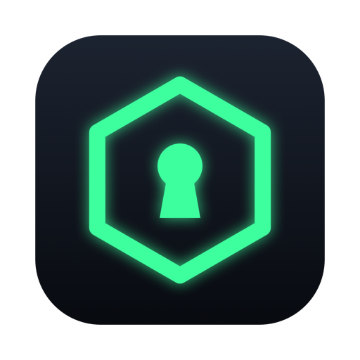
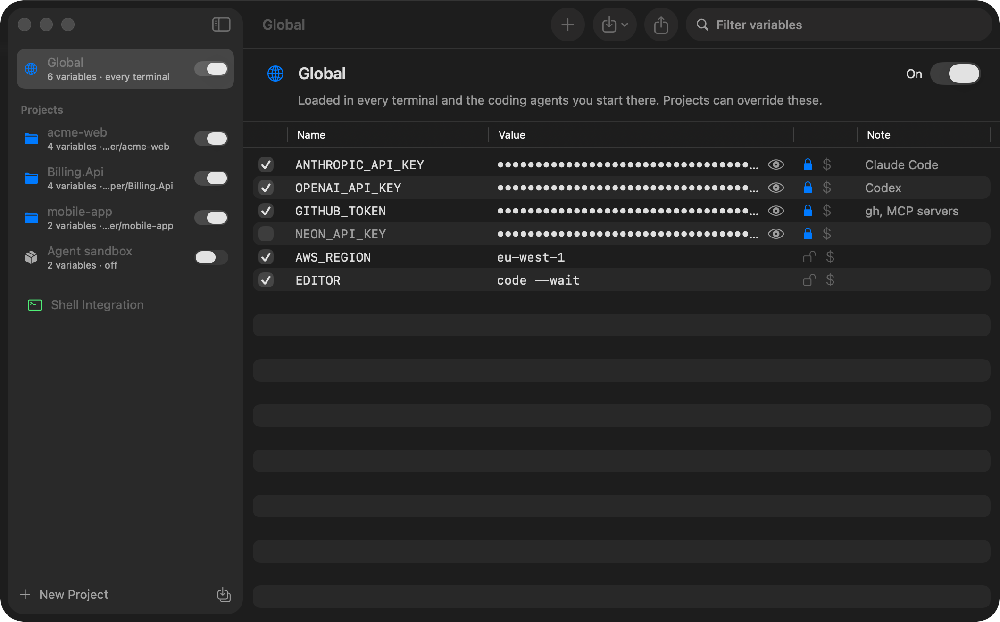

<p align="center">
  
</p>

<h1 align="center">Envy</h1>

<p align="center">
  <strong>Environment variables & secrets for your terminal and AI coding agents — native macOS, 100% free & open-source.</strong>
</p>

<p align="center">
  <a href="https://github.com/joeystdio/envy/releases/latest/download/Envy.dmg">
    
  </a>
  <a href="https://github.com/joeystdio/envy/releases/latest">
    
  </a>
  
  
  <a href="https://buymeacoffee.com/joeystdio">
    
  </a>
</p>

<p align="center">
  
</p>

---

## ✨ Features

- **🔐 Secrets in your Keychain, not your dotfiles**: API keys and tokens live in the macOS Keychain and are masked in the app. No more `export OPENAI_API_KEY=…` in plain text in `~/.zshrc`, where every program you run (coding agents included) can read it.
- **🌍 Global + per-project variables**: Keep **Global** variables that load in every terminal, plus a set per project that adds to or overrides them.
- **📂 Folder-aware, direnv-style**: Link a project to a folder and its variables load the moment a terminal `cd`s in, and unload when it leaves. Anything they overrode gets its old value back.
- **🎚️ One-click on/off**: Switch a whole project or a single variable on or off, from the window or the **menu bar**. Open terminals pick it up at their next prompt, no restart needed.
- **🤖 Built for coding agents**: Claude Code, Codex, Cursor CLI, Gemini CLI, Aider and friends get exactly what's switched on for the folder you start them in, and nothing else.
- **📥 Import everything**:
  - Scan a whole folder of code at once for `.env`, `.env.local` and `.envrc` files.
  - **.NET**: `appsettings.json`, `appsettings.Development.json` and `dotnet user-secrets`, flattened the way .NET reads them (`ConnectionStrings:Default` → `ConnectionStrings__Default`).
  - Paste or drop `.env` text, copy variables between projects, export back to `.env`.
- **🧭 Setup Assistant**: Detects your shell (zsh or bash, `ZDOTDIR`, dotfile symlinks) and the coding agents you have installed. It then connects your terminal, checks that a fresh shell loads Envy, and moves plain-text secrets out of your startup files into the Keychain.

---

## 📦 Installation

### Option 1: Homebrew (Recommended)
```bash
brew tap joeystdio/tap
brew install --cask envy
```

### Option 2: Direct Download (`.dmg`)
1. Download [**`Envy.dmg`**](https://github.com/joeystdio/envy/releases/latest/download/Envy.dmg) from the [latest release](https://github.com/joeystdio/envy/releases/latest).
2. Open `Envy.dmg` and drag **Envy.app** into your **Applications** folder.
3. Launch **Envy**. The Setup Assistant connects your terminal and imports your projects.

> Envy is signed with a Developer ID and **notarized by Apple**, so it opens without any Gatekeeper warnings.

---

## 🚀 Using Envy

Envy adds one marked line to `~/.zshrc` (and/or `~/.bashrc`, `~/.bash_profile`). From then on, every terminal loads whatever you switch on:

| Scope | Loads |
| --- | --- |
| 🌍 **Global** | In every terminal |
| 📦 **Project without a folder** | In every terminal, on top of Global |
| 📂 **Project with linked folders** | Only inside those folders (and subfolders) |

Later wins: Global, then always-on projects (sidebar order), then folder projects (deepest folder last).

In a terminal:

```bash
envy status   # which projects and variables are loaded here
envy reload   # reload right now
envy open     # open the app
```

- **🔒 Secret**: stored in the Keychain and masked in the app.
- **💲 Expand**: the value is evaluated like a double-quoted shell string, so `$HOME/bin:$PATH`, `${OTHER}`, `~` and `$(command)` work. Off by default, so values pass through literally.
- **Shortcuts**: ⌘N new variable, ⇧⌘N new project, ⌘I import `.env`, ⇧⌘I import projects from a folder, ⇧⌘E export `.env`, ⌘Z undo.

<details>
<summary><strong>How the shell hook works</strong></summary>

The line in your startup file sources `~/.config/envy/init.sh`. The app regenerates `~/.config/envy/vars.sh` (mode 600) whenever you change something. At every prompt, and on `cd` in zsh, the hook checks a generation stamp and the current folder. When either changed, it puts back everything it set earlier and applies the current set. New tabs, tmux panes and editor terminals inherit what their parent applied and clean it up correctly.

Disconnecting from **Shell Integration** removes the line again; a copy of the previous file is kept as `<file>.envy-backup`.
</details>

---

## 🛠️ Building from Source

Requires macOS 15.0+ and Xcode 16+ (Swift 6 toolchain):

```bash
git clone https://github.com/joeystdio/envy.git
cd envy
swift test                      # core tests, including real zsh and bash runs of the hook
scripts/build-app.sh --install  # builds dist/Envy.app and copies it to /Applications
```

This compiles a Universal Binary (`arm64` Apple Silicon + `x86_64` Intel) and bundles `Envy.app`. It signs with your **Developer ID Application** certificate when you have one, so the Keychain keeps trusting Envy across rebuilds; otherwise it signs ad-hoc. Set `CODESIGN_IDENTITY` to choose another identity, or `-` for ad-hoc.

To try it without touching your real setup, point it at a sandbox folder. Settings, secrets (as a file instead of the Keychain), shell files and startup files then all live there:

```bash
open -n --env ENVY_HOME=/tmp/envy-sandbox dist/Envy.app
```

<details>
<summary><strong>Releasing a new version</strong></summary>

`scripts/release.sh` builds `dist/Envy.dmg`, signs it with your Developer ID, has Apple notarize it and staples the ticket. It uses the notarization credentials saved in your Keychain as `notarytool-profile` (set `NOTARY_PROFILE` for another name). To save them on a new Mac, with an app-specific password from [account.apple.com](https://account.apple.com):

```bash
xcrun notarytool store-credentials notarytool-profile --apple-id you@example.com --team-id R78A8G6R2N
```

Then:

```bash
VERSION=1.0.2 scripts/release.sh
gh release create v1.0.2 dist/Envy.dmg --title "Envy 1.0.2" --generate-notes
```

The DMG keeps the same name for every version, so the download links above always serve the newest release. Update `version` and `sha256` in the [Homebrew cask](https://github.com/joeystdio/homebrew-tap/blob/main/Casks/envy.rb) too.
</details>

---

## ☕ Support & Buy Me a Coffee

Envy is 100% free and open-source. If it keeps your secrets out of your dotfiles and your agents well-fed, consider buying me a coffee!

<p align="left">
  <a href="https://buymeacoffee.com/joeystdio">
    
  </a>
  <a href="https://paypal.me/joeystdio">
    
  </a>
</p>

---

## 📄 License

MIT License — completely free and open source forever.
